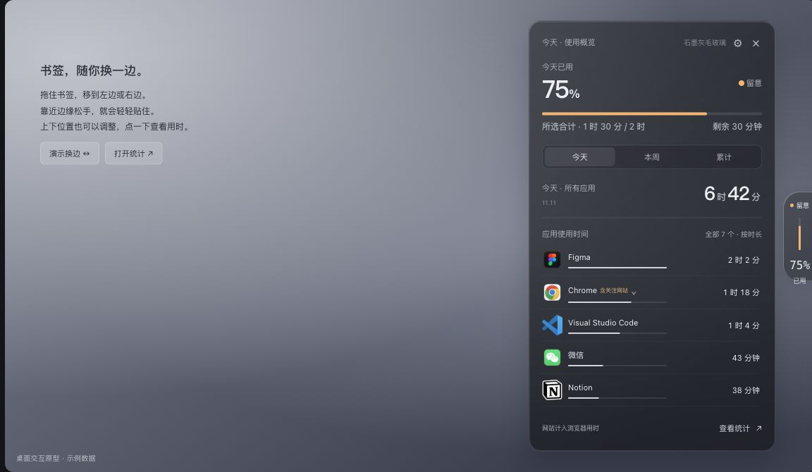
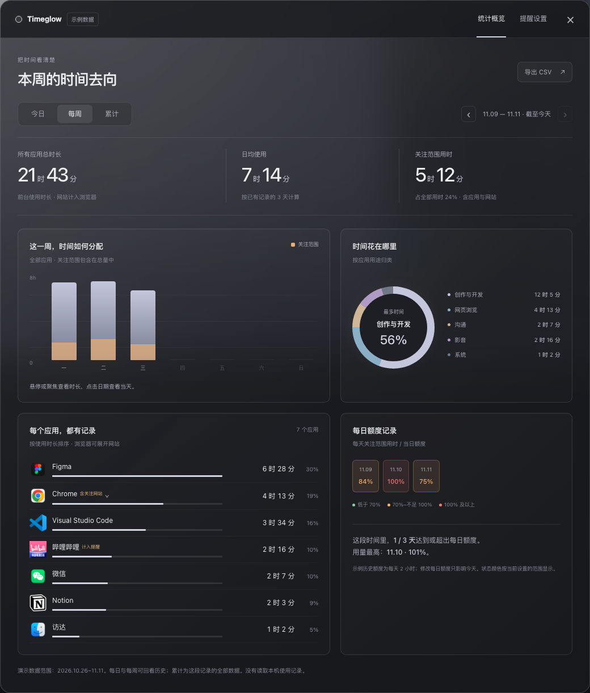
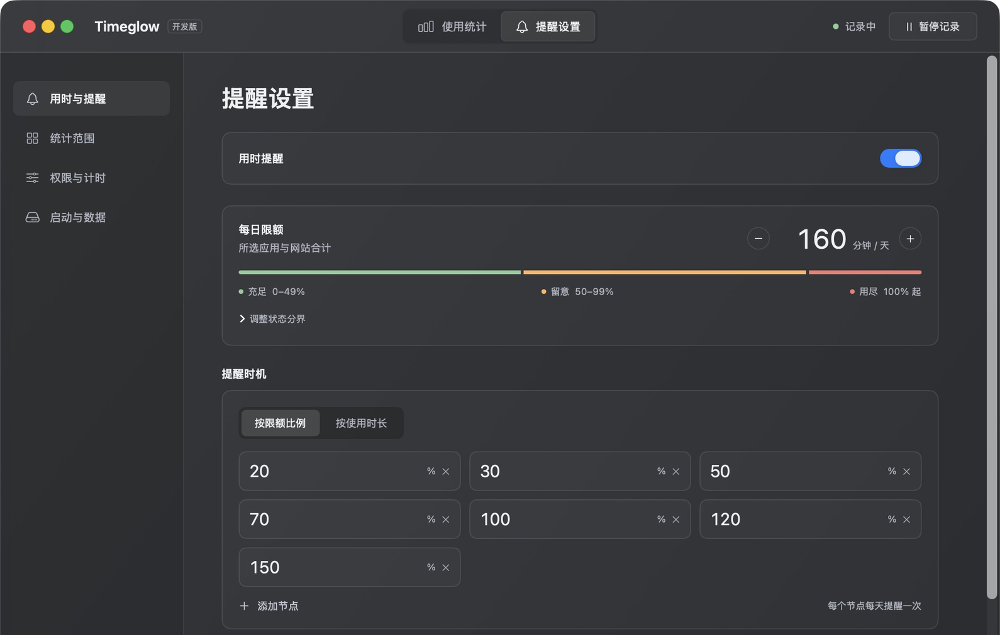
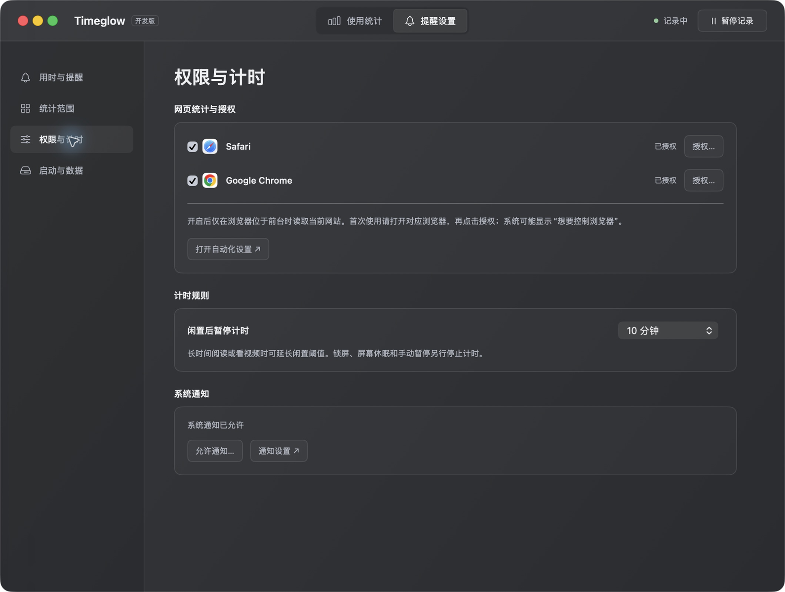

<div align="center">
  
  <h1>Timeglow</h1>
  <p><strong>看见时间去向，在合适的时候停一下。</strong></p>
  <p>macOS 26+ · SwiftUI / AppKit · 本地记录</p>
</div>

Timeglow 是一款原生 Mac 应用与网站用时管理工具。它自动记录前台应用和网站的使用时间，用屏幕边缘的小书签显示今天的用时进度，并在达到你设定的节点时提醒你。

你可以查看整台 Mac 的时间去向，也可以挑选几款应用和几个网站，为它们设置一个共用的每日限额。

需要直接安装时，请从 [GitHub Releases](https://github.com/klosexf/Timeglow/releases) 下载对应版本的 macOS 安装包。



<p align="center"><sub>贴边书签与展开概览 · 示例效果图</sub></p>

## 功能

| 功能 | 可以做什么 |
| --- | --- |
| 自动记录用时 | 记录前台应用的使用时长；授权后，进一步查看 Safari 和 Google Chrome 中的网站用时 |
| 贴边书签 | 左右停靠、拖动调整高度，随时查看今天已用每日限额的百分比 |
| 使用概览 | 点击书签展开面板，查看合计用时、剩余时长、应用排行和浏览器网站明细 |
| 使用统计 | 切换今日、每周与累计，查看趋势、用途分类、应用排行和每日合计用时记录 |
| 自定统计范围 | 选择应用、添加网站；可选整个浏览器，也可只选其中的网站 |
| 多节点提醒 | 按限额比例或累计分钟数设置多个节点，编辑自己的提醒文案 |
| 数据与运行 | CSV 导出、暂停与继续记录、闲置排除，以及可选的登录自动启动 |

## 界面与使用方式

### 贴边书签，随时查看今天的进度

Timeglow 启动后显示贴边书签和菜单栏图标。日常使用时，书签停靠在屏幕边缘；点击展开使用概览，再点书签或面板外部即可收起。

书签可以拖到屏幕左侧或右侧，并保留停靠位置。状态分为「充足」「留意」「警戒」，用颜色和百分比显示每日限额的使用情况，分界可以自行调整。

概览中的应用列表支持今天、本周与累计。顶部的限额进度始终对应今天，展开浏览器后可以继续查看网站明细。

### 使用统计，看清时间花在哪里



<p align="center"><sub>周统计功能示意 · 示例数据</sub></p>

- **日、周、累计**：默认查看本周。点选日期可以查看该日并返回原区间。
- **用时趋势**：今日按时段展示，每周按日期展示。
- **类别占比**：查看创作与开发、网页浏览、沟通等用途的时间分布。
- **应用与网站排行**：按用时排序，浏览器下展开网站明细。
- **每日合计用时记录**：查看所选应用和网站每天用了多少限额。
- **CSV 导出**：导出当前统计周期的每日应用用时，便于继续整理。

原生统计页中的应用和网站名称旁提供加号，可以直接加入统计范围。

### 自定每日限额和提醒节点



<p align="center"><sub>用时与提醒 · 早期版本界面，展示限额与节点设置</sub></p>

先选择要计入限额的应用和网站，再设置它们每天合计最多使用多久。例如，把几个视频网站和一款应用加入范围，共用每天 120 分钟的限额。

提醒支持两种方式：

- **按限额比例**：例如在用到 50%、80%、100% 时提醒。
- **按使用时长**：例如在合计使用 30、60、90 分钟时提醒。

每个节点每天提醒一次，次日重新计算。两组节点配置都会保留，点击保存后，所选方式生效。提醒方式、节点和文案编辑后需点击「保存设置」。切换设置分类或主导航会保留草稿。

到达限额后，Timeglow 会提示你，你仍可自行决定是否继续使用。

### 点击通知，读到自己写下的提醒

你可以写下一句最多 80 字的提醒。点击系统通知后，Timeglow 会打开独立的自我提醒窗口，根据提醒方式展示用时比例或累计分钟数，并保留文案的换行。

点击「知道了」或按 Esc 会收起提醒，计时继续。从设置演示时，会回到原先的编辑位置。历史通知会显示对应提醒的日期与快照。

### 权限与计时，按需要开启



<p align="center"><sub>权限与计时 · 早期版本界面</sub></p>

应用用时记录无需辅助功能或屏幕录制权限。网站统计需要你主动为 Safari 或 Google Chrome 授予自动化权限；系统通知与登录自动启动也由你选择开启。

可以设置闲置多久后暂停计时，或关闭自动闲置排除。长时间阅读、观看视频时，建议根据使用习惯调整这个阈值。锁屏、屏幕休眠与手动暂停时会停止计时。

> 图片展示统计和设置功能的早期布局。当前版的窗口尺寸、字体与交互规则见[界面设计规范](DESIGN.md)。

## 第一次使用

1. 启动 Timeglow，点击屏幕边缘的书签展开概览。
2. 点击概览中的齿轮，或通过菜单栏「设置…」打开设置；快捷键为 `⌘,`。
3. 在「统计范围」中选择要计入每日限额的应用和网站。首次启动时，这个范围为空。
4. 如需网站明细，在「权限与计时」中打开对应浏览器并点击「授权…」。
5. 在「用时与提醒」中设置每日限额、提醒节点和文案，保存设置，并按需要允许系统通知。

关闭主窗口后，Timeglow 会继续通过书签和菜单栏运行。需要结束记录时，从菜单栏选择「退出 Timeglow」。

## 用时如何计算

Timeglow 提供两个相互关联的数字：

| 指标 | 含义 |
| --- | --- |
| 所有应用总时长 | 所有应用在前台使用的总时间，用于查看整体时间去向 |
| 所选应用和网站合计用时 | 统计范围内的使用时间，用于计算每日限额进度和触发提醒 |

**已用百分比 = 今天所选应用和网站合计用时 ÷ 每日限额。**

取消勾选的项目仍会记录用时，只是不再计入这份限额。选中整个浏览器后，其中的网站随浏览器一起计入；如果只想限制某些网站，添加网站即可，无需勾选整个浏览器。浏览器与网站重叠的时间只计算一次。

网站按域名及其子域名归并，页面路径和查询参数不参与匹配。

## 数据与隐私

- 使用记录保存在本机 SQLite 数据库中，无需注册账号。
- 网站记录只保存域名，不保存网页正文、完整网址路径、查询参数或窗口标题。
- 闲置判断使用距上次输入的时间，不读取键入内容。
- 展开网站明细时，应用会按需向对应网站请求图标；请求不携带浏览器 Cookie 或登录凭据，图标缓存在本机。
- 可在「启动与数据」中查看本地记录位置，或从统计页导出 CSV。

## 从源码构建

应用工程要求 **macOS 26.0 或更高版本**，使用 Xcode 26 或更新版本打开 `Timeglow.xcodeproj`，选择 Timeglow / My Mac 运行，并配置本机可用的开发签名证书。

也可以在终端执行：

```sh
git clone https://github.com/klosexf/Timeglow.git
cd Timeglow
bash scripts/build-development.sh
open ../outputs/native/Timeglow.app
```

构建脚本默认面向 Apple Silicon，产物位于仓库同级的 `outputs/native/Timeglow.app`。这是开发签名版本，尚未公证或上架 Mac App Store。Debug 与 Release 的使用记录和提醒设置相互隔离。

开发者可继续阅读[开发与计时说明](docs/development.md)，了解项目结构、核心测试、数据存储和排查方式。
